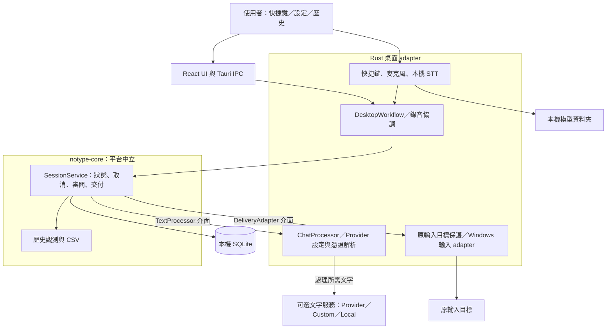
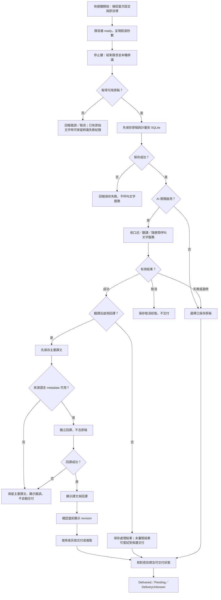
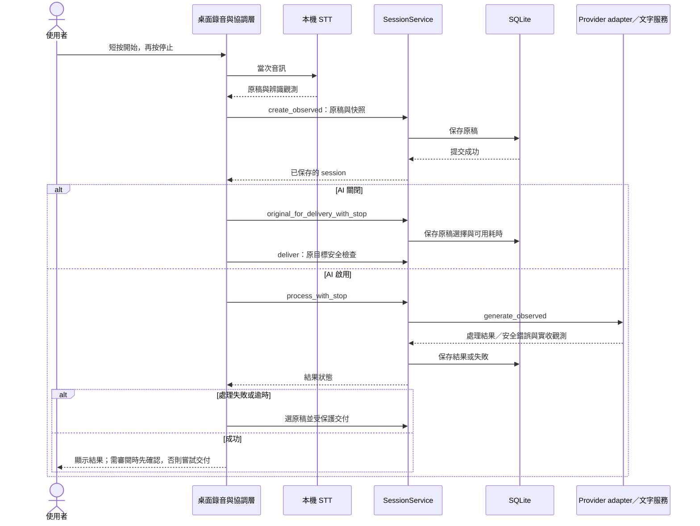
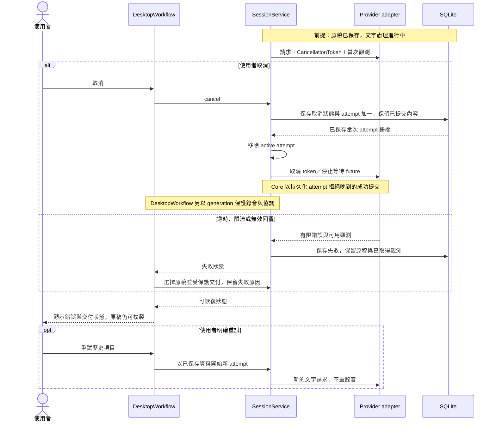
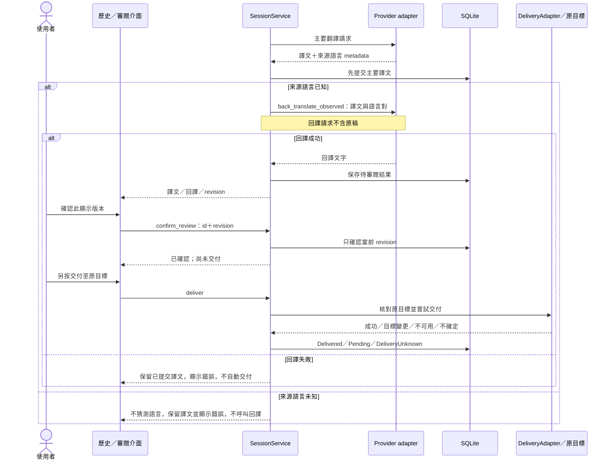
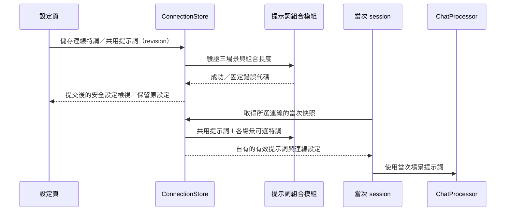

# notype 開發者手冊

這份手冊用來說明設計、架構、流程與程式碼位置，協助開發、審查及交接。使用者介紹與安裝請見 [README](README.md)；當前待辦見 [HANDOFF](HANDOFF.md)／[TODO](TODO.md)。

設定搬移的模組分工、流程與重啟時序見 [YAML 設計](docs/settings-transfer-design.md)。
來源已接上進階設定的匯出／預覽／整份取代流程；原生重新啟動與新套件驗收仍另列。

- [設計原則與取捨](#設計原則與取捨)
- [架構與責任邊界](#架構與責任邊界)
- [主要流程](#主要流程)
- [時序圖](#時序圖)
- [資料夾導覽](#資料夾導覽)
- [重要檔案](#重要檔案)
- [開發與建置](#開發與建置)
- [測試與協作](#測試與協作)
- [驗證狀態與待測清單](#驗證狀態與待測清單)

## 設計原則與取捨

notype 的基本工作單位是一次**語音 session**：開始錄音、停止、本機辨識、保存原稿、可選文字處理，再交付或保留待選結果。詞彙定義見 [GLOSSARY](GLOSSARY.md)。

| 設計原則 | 現有設計 | 取捨／需要驗證的部分 |
| --- | --- | --- |
| 本機語音辨識 | 音訊交由本機模型處理；文字 API 為可選服務 | 需要模型空間與 CPU；真人品質、噪音與完整 session 延遲仍待驗收 |
| 先保存，再處理 | 成功取得原稿後先寫入 SQLite，再呼叫文字服務 | 服務失敗仍可回查原稿；資料庫保存失敗時不可繼續當成成功 |
| 各層有明確責任 | 共用核心管理 session；平台 adapter 負責錄音、快捷鍵、路徑與輸入目標 | 方便跨平台共用規則，但各 OS 的實際權限與輸入行為須獨立驗收 |
| 明確的當次設定 | 使用場景、提示詞、模型與辨識模式等快照，搭配 generation／revision 保護 | 晚到回覆不能覆蓋後續工作；改設定不追溯改寫已保存的當次紀錄 |
| 交付可判定 | 核對原輸入目標；交付不確定時記錄 DeliveryUnknown | 無法確認時保留結果；五個目標 App 的自動輸入未完成新版驗收 |
| 保留觀測的不確定性 | tokens／費用可為完整、部分或未知，實收金額按幣別保存 | 無回報不當成零，不以牌價推算；取消不構成沒有用量的證據 |
| 配送與個人資料分離 | portable 程式、模型資料夾、設定／歷史分開 | 模型由使用者自行搬移；App 選取與重新掃描不代替搬移 |

本版交付 Windows amd64 的錄音／本機辨識／歷史／複製與受保護的標準文字欄／Notepad++ 輸入。macOS／Linux 桌面版及五 App 自動輸入完整驗收屬後續範圍。10～20秒錄音停止至交付 p95≤5秒仍是待驗證目標。決策依據見 [portable 配送 ADR](docs/adr/0001-portable-npm-distribution.md)、[歷史與錄音分離 ADR](docs/adr/0002-text-history-independent-of-audio.md)、[共用核心 ADR](docs/adr/0003-shared-core-platform-adapters.md)。

## 架構與責任邊界

最新 AI server 狀態、設定分頁與特調提示詞的來源／原生編譯／指定畫面驗收邊界，見 [#33／#34 驗證紀錄](docs/verification/server-tuning-status.md)。[YAML 移轉設計與測試範圍](docs/settings-transfer-design.md)已記錄全部資料政策；codec／provider archive 的來源基礎已有測試，整份交易、UI 及交付仍在實作。

正式 App 使用 **Rust + Tauri 2 + React／TypeScript + SQLite**。桌面來源基於固定 Handy fork，來源與 MIT 授權見 [UPSTREAM](desktop/UPSTREAM.md)／[LICENSE](desktop/LICENSE)。下圖描述現有模組責任，不表示所有平台或實機場景均已驗收。



| 層 | 負責 | 邊界 |
| --- | --- | --- |
| React／Tauri IPC | 設定、歷史、語系、錄音提示與使用者動作 | 用安全 DTO 與 revision 處理回覆；已存 key 僅回傳遮罩頭尾，實際值不回傳 |
| 桌面協調層 | 音訊生命週期、辨識模式、當次設定、generation、結果通知 | 將外部事件接到核心；只有有效 generation 可建立當次工作結果 |
| notype-core | 原稿與結果、session 狀態、重試／回譯／確認、交付及 SQLite | 不自行取得 OS 視窗、麥克風、憑證或介面語言 |
| Provider adapter | 請求映射、提示詞、能力、HTTP、錯誤與用量 | 遠端內容與秘密不直接成為可公開診斷；目前文字請求採非串流回應 |
| 平台 adapter | CPU／權限／資料路徑探測、原目標與插入保護 | 平台中立測試不等於 Windows 實機或其他 OS 驗收 |
| Portable 配送 | Node facade、manifest、完整 runtime 與模型 pin | 源碼模板未組裝；完整性檢查不啟動 App、不代表主機相容 |

**資料流與隱私。** 語音由本機 STT 處理；啟用文字服務後，所需原稿、術語與允許的 App 名稱情境可交給所選端點。網站網域、頁面及輸入內容不作為情境來源。文字歷史位於本機，不能因此推論遠端 provider 的保留或訓練政策。

**正式核心與舊 prototype。** 根目錄 `src/` 的 Node 流程是診斷 prototype；其 `{transcript, glossary} → {text}` 是開發 loopback contract。正式 session 在 Rust，桌面文字服務使用 OpenAI 相容 adapter。不要從根目錄 Node 原型推論桌面 IPC 或公司 API 格式。

## 主要流程



來源：[DesktopWorkflow](desktop/src-tauri/src/workflow.rs)、[辨識協調](desktop/src-tauri/src/transcription_coordinator.rs)、[SessionService](crates/notype-core/src/lib.rs)。辨識未產生文字不應假造原稿；已有原始文字但字形正規化失敗時，可透過 `finish_recognition_failure` 保存失敗原稿，不呼叫文字服務或自動交付。

目前開發版本的 `DesktopWorkflow.finish`／`retry` 在 AI 關閉時直接選擇原稿；AI 處理失敗或逾時也會選擇原稿，保留錯誤原因並嘗試受保護交付。取消不進入此路徑，辨識字形失敗也不自動交付。成功且不需審閱的處理結果會交付；回譯審閱仍需確認。已交付或不確定寫入不會重送。這些行為不代表所有目標 App 的相容性已通過。

### 原輸入目標與剪貼簿

標準 Windows Edit／RichEdit 使用定向 Unicode 插入；Notepad++ Scintilla 使用定向 `WM_PASTE`。兩者保留原程序建立身分、文件、焦點、游標與選取範圍檢查，原生 handle 只留記憶體。Scintilla 使用 UTF-8 byte 位置，並依文件換行設定檢查結果；不讀取既有文件文字。其他 App 尚未被這個 adapter 自動涵蓋。

剪貼簿貼上先不透明備份可保存的格式，完成後還原；新的使用者複製優先保留。暫存文字附 Windows 剪貼簿歷史／雲端排除格式。呼叫端等待上限為兩秒；超時後可能已寫入，保留不確定狀態且不重送，清理 worker 等接收端完成後才還原。完整限制與實測見 [#31 receipt](docs/verification/usability.md)。

### 設定與連線用量

詞彙表是獨立設定頁；前端與後端共同驗證長度、控制字元、前後空白及大小寫重複，後端確認保存成功才回覆。CSV 為單欄 `word`、UTF-8 BOM；匯入先解析整份，格式錯誤不部分套用。

連線設定保留多筆、僅一筆 active，全域 AI 開關套用三個場景。只有遮罩 key 預覽可傳到 UI；實際 key 仍依既有 app 設定優先於家目錄 `.env`。測試連線是明確、短限時的實際請求，不更改 active、不建立語音歷史。

`connection_activity_v1.db` 獨立記錄每筆連線的安全呼叫描述與 provider receipt，不包含提示詞、原稿、端點或 key。正式生成、重試、回譯與測試均使用相同 observer。統計不依賴歷史是否刪除；清除使用量刪該連線 ledger，遲到回覆只更新既有 row，不能復活清除前資料。費用採確切十進位、各幣別分開；缺資料保留未知。UI 最近測試狀態須符合目前設定 revision，不能用已填設定推論連線成功。

## 時序圖

### 口述、原稿保存與可選文字處理



圖中省略保存／辨識失敗，分支見上一節。`TextProcessor` 是核心介面，`ChatProcessor` 是桌面 HTTP 實作；原稿先保存是兩者呼叫順序的前提。

### 已保存原稿後的取消、API 失敗與重試



取消先持久化狀態與 attempt 柵欄，再通知執行中的工作停止；DesktopWorkflow 的 generation 與核心 attempt 各自負責不同層次。取消前若已提交主要譯文，該內容仍可恢復。上圖限定文字處理階段：交付中取消／中斷是另一個邊界，可能成為 `DeliveryUnknown`，不得直接重送。呼叫方應保持有限逾時、取消與錯誤映射；目前 HTTP client 關閉自動 transport retry，使用者重試是新的可觀測 attempt。來源：[核心](crates/notype-core/src/lib.rs)、[Provider](desktop/src-tauri/src/faithful_provider.rs)。

### 回譯審閱、確認與交付



回譯是人工比較工具，不是品質認證。重試或選回原稿會改變 revision 並清除舊審閱確認；確認本身不切換視窗或插入文字。若原目標變更／不可用，結果保持待選；可能已插入卻無法確認時記錄 `DeliveryUnknown`，避免重複輸入。來源：[核心審閱／交付](crates/notype-core/src/lib.rs)、[native_input](desktop/src-tauri/src/native_input.rs)。

## 資料夾導覽

以下列追蹤中的來源目錄；模型、個人資料及開發產物另行保存。

```text
notype/
├── README.md / development.md       使用者文件／開發手冊
├── AGENTS.md / GLOSSARY.md           工作規則／共同術語
├── HANDOFF.md / TODO.md              交接／待辦
├── crates/
│   ├── notype-core/                 session、SQLite、CSV 與共用錯誤
│   └── notype-platform/             獨立 host／CPU／權限探測 helper
├── desktop/
│   ├── src/                         React／TypeScript
│   │   ├── components/              設定、歷史、模型與支援介面
│   │   ├── hooks/ / stores/         IPC 操作與前端狀態
│   │   ├── i18n/                    語系與翻譯資源
│   │   ├── overlay/                 錄音提示入口
│   │   └── lib/                     型別、表單與診斷工具
│   ├── src-tauri/
│   │   ├── src/                     Rust 桌面 adapter
│   │   │   ├── commands/            Tauri IPC handlers
│   │   │   ├── managers/            音訊、模型、歷史管理
│   │   │   ├── audio_toolkit/       錄音、重採樣與 VAD
│   │   │   └── shortcut/            快捷鍵後端
│   │   ├── resources/               執行資源
│   │   └── capabilities/            Tauri 權限宣告
│   └── .cargo/                      Windows MSVC UTF-8 設定
├── packages/
│   ├── notype/                      Node portable launcher
│   ├── notype-win32-x64/             Windows payload 來源模板
│   └── notype-model/                模型來源模板
├── src/                             舊 Node 診斷 prototype
├── scripts/                         政策檢查與 provider probe 入口
├── tests/unittest/                  Rust／Node／UI unit tests
├── tests/integration/               SQLite／HTTP／UI／封裝／原生整合
├── docs/adr/                        架構決策
├── docs/agents/                     工作與審查規則
├── docs/research/                   研究、選型與決策歷史
├── docs/verification/               分範圍驗證證據
└── .github/workflows/               契約與 Windows probe CI
```

`node_modules/`、`dist/`、Rust `target/` 是本機產物；`desktop/src-tauri/transcribe-libs/` 是原生 library staging 區，不能把整個開發快取當成可配送 payload。上游文件保留供參考，notype 的規則與 CPU-only／portable 政策以 [desktop/AGENTS.md](desktop/AGENTS.md)、[desktop/NOTYPE.md](desktop/NOTYPE.md) 及根目錄規則為準。

## 重要檔案

連線特調的有效提示詞在建立當次設定快照時組合，流程如下；None 使用共用提示詞原文，特調僅附加於相同場景。儲存共用提示詞或連線時會先驗證全部受影響組合，拒絕過長內容並保留舊設定。



| 工作範圍 | 主要檔案 | 職責 |
| --- | --- | --- |
| 前端入口 | [main.tsx](desktop/src/main.tsx)、[App.tsx](desktop/src/App.tsx) | 掛載及主要介面組合 |
| IPC／前端狀態 | [bindings.ts](desktop/src/bindings.ts)、[settingsStore.ts](desktop/src/stores/settingsStore.ts)、[modelStore.ts](desktop/src/stores/modelStore.ts) | 命令型別與 UI 狀態 |
| 連線設定 | [ConnectionEditor.tsx](desktop/src/components/settings/post-processing/ConnectionEditor.tsx)、[ModelIdList.tsx](desktop/src/components/settings/post-processing/ModelIdList.tsx) | 多連線編輯、模型清單參考 |
| Server 特調 | [ConnectionPromptTuning.tsx](desktop/src/components/settings/post-processing/ConnectionPromptTuning.tsx)、[provider_prompt_tuning.rs](desktop/src-tauri/src/provider_prompt_tuning.rs) | 三場景獨立補充規則、長度驗證與 session 提示詞組合 |
| 模型與診斷 UI | [ModelFolderControl.tsx](desktop/src/components/settings/models/ModelFolderControl.tsx)、[DiagnosticsSupport.tsx](desktop/src/components/settings/about/DiagnosticsSupport.tsx) | 模型位置、診斷偏好與匯出 |
| 語系 | [i18n/index.ts](desktop/src/i18n/index.ts)、[locales/](desktop/src/i18n/locales/) | 載入及語系資源 |
| 原生入口 | [main.rs](desktop/src-tauri/src/main.rs)、[lib.rs](desktop/src-tauri/src/lib.rs) | 程式入口、Tauri setup、服務組裝 |
| Session 協調 | [workflow.rs](desktop/src-tauri/src/workflow.rs)、[transcription_coordinator.rs](desktop/src-tauri/src/transcription_coordinator.rs) | DesktopWorkflow 與當次錄音／辨識協調 |
| 啟動與復原 | [runtime_startup.rs](desktop/src-tauri/src/runtime_startup.rs)、[offline_bootstrap.rs](desktop/src-tauri/src/offline_bootstrap.rs) | 初始化、離線預設與可重試復原 |
| 音訊與辨識 | [audio.rs](desktop/src-tauri/src/managers/audio.rs)、[transcription.rs](desktop/src-tauri/src/managers/transcription.rs) | 錄音及辨識引擎管理 |
| 模型生命週期 | [model.rs](desktop/src-tauri/src/managers/model.rs)、[model_roots.rs](desktop/src-tauri/src/managers/model_roots.rs)、[model_transfer_worker.rs](desktop/src-tauri/src/managers/model_transfer_worker.rs) | 模型選擇、資料夾政策及背景工作 |
| 按鍵與提示 | [physical_gestures.rs](desktop/src-tauri/src/physical_gestures.rs)、[capture_startup.rs](desktop/src-tauri/src/capture_startup.rs)、[overlay_lifecycle.rs](desktop/src-tauri/src/overlay_lifecycle.rs) | 實體按鍵、收音 ready、提示生命週期 |
| 交付與視窗 | [native_input.rs](desktop/src-tauri/src/native_input.rs)、[window_lifecycle.rs](desktop/src-tauri/src/window_lifecycle.rs)、[tray.rs](desktop/src-tauri/src/tray.rs) | 原目標保護、系統匣與還原 |
| Notepad++ 貼上 | [native_clipboard.rs](desktop/src-tauri/src/native_clipboard.rs)、[native_target_policy.rs](desktop/src-tauri/src/native_target_policy.rs) | 原生定向貼上、剪貼簿備份／還原、編碼與控制項支援 |
| 詞彙與簡易歷史 | [DictionarySettings.tsx](desktop/src/components/settings/DictionarySettings.tsx)、[HistorySettings.tsx](desktop/src/components/settings/history/HistorySettings.tsx) | 詞彙表、CSV、時間／文字與搜尋反白 |
| 連線用量與狀態 | [connection_activity.rs](desktop/src-tauri/src/connection_activity.rs)、[useConnectionActivity.ts](desktop/src/hooks/useConnectionActivity.ts) | 獨立用量、測試 admission／結果、設定 revision 與 UI 刷新 |
| 文字 API | [faithful_provider.rs](desktop/src-tauri/src/faithful_provider.rs)、[provider_config.rs](desktop/src-tauri/src/provider_config.rs) | ChatProcessor、場景提示詞、設定與映射 |
| 能力／key／模型列表 | [provider_capabilities.rs](desktop/src-tauri/src/provider_capabilities.rs)、[provider_credentials.rs](desktop/src-tauri/src/provider_credentials.rs)、[provider_models.rs](desktop/src-tauri/src/provider_models.rs) | thinking／effort、憑證來源、模型列表 |
| 診斷 | [diagnostic_service.rs](desktop/src-tauri/src/diagnostic_service.rs)、[diagnostic_privacy.rs](desktop/src-tauri/src/diagnostic_privacy.rs) | 收集偏好、可匯出內容及敏感資訊處理 |
| 核心 | [notype-core/src/lib.rs](crates/notype-core/src/lib.rs) | SessionService、TextProcessor、DeliveryAdapter |
| 歷史與 CSV | [observations.rs](crates/notype-core/src/observations.rs)、[observation_store.rs](crates/notype-core/src/observation_store.rs)、[csv.rs](crates/notype-core/src/csv.rs) | 字數、耗時、模型／用量／費用與匯出 |
| 錯誤與 host | [gateway_error.rs](crates/notype-core/src/gateway_error.rs)、[host.rs](crates/notype-platform/src/host.rs) | 共用服務錯誤、主機 CPU／權限／路徑探測 |
| 配送 | [notype.mjs](packages/notype/bin/notype.mjs)、[launcher.mjs](packages/notype/lib/launcher.mjs)、[offline-bundle.mjs](packages/notype/lib/offline-bundle.mjs)、[manifest.mjs](packages/notype/lib/manifest.mjs) | CLI、啟動計畫、ZIP 與逐檔驗證 |
| 舊 prototype | [sessions.mjs](src/sessions.mjs)、[history.mjs](src/history.mjs)、[text-adapter.mjs](src/text-adapter.mjs) | Node 診斷流程與 loopback adapter |

## 開發與建置

一般使用者下載完整 ZIP 即可；下面的工具只用於從來源開發。這些是命令參考，**不是這次文件重整已執行的建置／測試結果**。

| 工作 | 工具與前置條件 |
| --- | --- |
| 來源與 Node 契約 | Git、private repo 存取權、Node.js 22.15.0 以上及 npm；CI 使用 22.15.0 |
| 桌面前端 | Bun，依 `desktop/bun.lock` 安裝；目前 CI 使用 1.2.22 |
| Rust 契約 | Rust toolchain／Cargo；核心宣告 rust-version 1.89，目前核心 CI 使用 1.99.1 |
| Windows 原生 | Rust MSVC、Visual Studio C++ Build Tools、Windows SDK、CMake、相依 crate 所需 LLVM／libclang 與原生函式庫 |
| Rendered UI 測試 | 前端依賴與瀏覽器；Windows 預設 Edge，其他環境按測試規範準備 |

根目錄沒有統一 Cargo workspace；各 crate／desktop-contracts 有自己的 workspace，請明確指定 `--manifest-path`。notype 的 Windows build 採 CPU backend，不需要照上游通用 BUILD 指南安裝 Vulkan。`desktop/.cargo/config.toml` 的 MSVC `_CL_=/utf-8` 用來正確解碼 C++；不應改寫全域 Cargo 設定。

### 取得來源與前端依賴

```powershell
git clone https://github.com/swchen44/notype.git
cd notype
npm.cmd ci --ignore-scripts
bun install --cwd desktop --frozen-lockfile --ignore-scripts
```

### 檢查與建置入口

從 repository root 執行：

```powershell
bun run --cwd desktop lint
bun run --cwd desktop build
node scripts/test-desktop-policy.mjs
```

原生開發視窗與 Release 先準備 Windows 工具鏈、VAD／原生函式庫及 runtime，詳見 [desktop/NOTYPE.md](desktop/NOTYPE.md)、[原生基線](docs/verification/windows-desktop-baseline.md)及[組裝規範](packages/ASSEMBLY.md)。在 `desktop/` 執行，以載入該目錄的 Cargo 設定：

```powershell
cd desktop

# 啟動開發 App
bun run tauri dev

# 原生 release，對應 tauri build --no-bundle
bun run build:portable
```

原生 exe 建置完成仍需組裝 native DLL、完整 Fixed WebView2、模型、聲音／VAD 資源與 notices。此命令不產生 installer，也不代表完整 ZIP、主機相容、GUI 或麥克風驗收已完成。編譯原生依賴與取得模型／runtime 需另行規劃網路及空間。

鎖檔為根目錄 `package-lock.json`、`desktop/bun.lock`、`desktop/src-tauri/Cargo.lock`，以及兩個 crate／desktop-contracts 內各自的 `Cargo.lock`。文件修改不更新依賴或鎖檔。

## 測試與協作

從 repository root 選擇相關範圍；完整條件見 [tests/README.md](tests/README.md)。

| 範圍 | 命令 | 驗證邊界 |
| --- | --- | --- |
| Node unit | `npm.cmd run test:unit` | prototype 與 portable 模組契約 |
| Node integration | `npm.cmd run test:integration` | HTTP／檔案／套件等受控整合 |
| UI unit | `npm.cmd run test:ui:unit` | UI 邏輯與語系等契約 |
| Rendered UI | `npm.cmd run test:ui:integration` | 真正 React 渲染、受控 IPC；需瀏覽器 |
| Rust 核心 | `cargo test --locked --manifest-path crates/notype-core/Cargo.toml` | session、SQLite、HTTP、審閱、觀測及 CSV |
| 平台 helper | `cargo test --locked --manifest-path crates/notype-platform/Cargo.toml` | 主機探測與可用性契約 |
| 桌面 unit 範例 | `cargo test --locked --manifest-path tests/integration/desktop-contracts/Cargo.toml --test desktop-workflow` | 正式 DesktopWorkflow，無完整 Tauri／音訊引擎 |
| 桌面 integration 範例 | `cargo test --locked --manifest-path tests/integration/desktop-contracts/Cargo.toml --test desktop-provider` | 正式 adapter、loopback HTTP 與 SQLite |

產品 unit tests 放 `tests/unittest/`，integration tests 放 `tests/integration/`。測試公開行為及真實模組組合；工作錄音、逐字稿與秘密不作 fixture。缺少必要環境時記錄未執行／unavailable，不能用 skip 或零項當成驗收通過。

`npm.cmd run test:runtime`、`*.runtime.mjs`、原生 library tests 及真實 provider probe 有不同前置條件。部分需要模型／CLI／Edge，部分會啟動 App、使用快捷鍵或操作自有輸入 fixture；先讀對應測試與驗證紀錄，再準備明確路徑、裝置、焦點、端點與付費預算。

[core-contracts.yml](.github/workflows/core-contracts.yml) 執行核心與 rendered UI 契約；[provider-probe-windows.yml](.github/workflows/provider-probe-windows.yml) 負責 Windows probe。Workflow 有 path filter、scope 或 skipped artifact job；須核對實際 run，不能把契約 CI 當作桌面成品、公司服務或所有 OS 通過。

工作使用 [GitHub Issues](https://github.com/swchen44/notype/issues)，依 [triage labels](docs/agents/triage-labels.md) 分類。先讀 [AGENTS](AGENTS.md)、[GLOSSARY](GLOSSARY.md)、相關 [ADRs](docs/adr/)；一般新實作計畫依 [plan-review](docs/agents/plan-review.md) 取得 GPT-6-Astra 審查；#31 已獲使用者明確豁免，仍完成規格、unit／integration 及獨立 Spec／Standards 審查。保留上游脈絡，但 notype 工作留在本 repo tracker。

## 設定、憑證與配送

- 預設持久資料為 `%APPDATA%\io.github.swchen44.notype`，有效絕對本機 `NOTYPE_DATA_DIR` 可選隔離位置；設定／`sessions.db`、程式與模型分開。資料庫有擁有權保護，交付不會合成 Enter。
- Provider／Custom／Local 可保存多筆、啟用一筆；model ID、thinking／effort 能力解析及安全 DTO 見 [Provider 設定契約](docs/provider-config-contract.md)。
- App 儲存的連線 key 優先；只有符合資格的官方路由才讀目前使用者家目錄 `.env` 的 `DEEPSEEK_API_KEY`、`OPENROUTER_API_KEY`、`GEMINI_API_KEY`。Custom／Local 不會拿到這些 fallback key，見 [provider_credentials.rs](desktop/src-tauri/src/provider_credentials.rs)。這不是讀取 repo `.env` 或任意環境變數的政策。
- 已存／已解析 key 不經安全設定 DTO 回傳；設定檔仍是敏感資料，UI 遮罩不代表加密保管。Git、Issue 及通用 ZIP 不應包含憑證、私人設定／歷史／錄音或未檢視的診斷匯出。
- 一般啟動不搬移、複製或下載已有模型。模型資料夾由使用者自行搬移後重新選取；既有個人設定優先於離線包預設。

`packages/notype/`、`notype-win32-x64/`、`notype-model/` 是 private、未組裝的來源模板；不能當成已發布 payload。根目錄 Node package 也只是 private 診斷專案。發行契約見 [ASSEMBLY](packages/ASSEMBLY.md)／[OFFLINE-BUNDLE](packages/OFFLINE-BUNDLE.md)。

正式離線包包含 launcher、指定 Node、App/native libraries、完整 Fixed WebView2、模型、逐檔 manifest 及 notices。`--check` 只驗證完整性，不建立使用者資料或啟動 App；執行環境仍須提供有效資料位置規劃。不得從此結果推論主機相容或真人品質。

發行分開記錄來源、建置、runtime／模型授權、實際 ZIP／獨立解壓、主機啟動及 GUI／品質／公司網路。保留第三方 notices；已知兩個 workspace crate 的 license metadata 缺口不因私人包稽核成功而消失，不宣稱公開再配送 clearance。

## 目前交付與來源

連線設定後續修正：[#32](docs/verification/provider-setup.md) 的產品來源 `90159a19c6e930abb06959e297f0656b08577a8e` 已完成原生本機候選 `0.1.1-local.3`，改善 key 入口／編輯引導；實際 DeepSeek 生成成功，OpenRouter 認證成功但免費生成限流。下面的 GitHub 全離線包仍為 v0.1.1-local.2，沒有被覆寫。

[v0.1.1-local.2](https://github.com/swchen44/notype/releases/tag/v0.1.1-local.2) 直接編譯產品來源 `d7d28645ec275c0b64b8590cc9013ffcc21f422c`；之後的文件 commit 不冒充二進位編譯來源。App 59,353,088 bytes，SHA-256 `e456219eb59d625680c452bdf6a1f987bbe6d1d3262ca1610b95eea063a33419`；ZIP 1,053,413,929 bytes，1,722 files／1,581,582,522 expanded bytes，SHA-256 `6a2a6d1875dcc5e2f5013e32b508e4738cf8afe045674e7c3cb6fb01843343b5`。

完整包重用已逐檔驗證的 runtime／模型，模型 pin 未變；不讀取或搬移使用者已有模型。完整 staged bundle、bundled Node `--offline-bundle --check`、嚴格 ZIP32 inventory／CRC／SHA 與實際獨立解壓已通過。外層四資產以 Release checksum 核對；產品測試及限制見 [#31 receipt](docs/verification/usability.md)。

### 舊版來源與歷史（v0.1.1-local.1）

[v0.1.1-local.1 private prerelease](https://github.com/swchen44/notype/releases/tag/v0.1.1-local.1) 的 ZIP 為1,062,634,288 bytes，含1,721 files／1,581,238,542 expanded bytes。完整性與[四個遠端資產雜湊](https://github.com/swchen44/notype/issues/14#issuecomment-6436789781)已核對。這次純文件重整沒有重新建置、更換或上傳該版本。

App 實際編譯來源為 `a180a2360009448cdf6e2f4f8e7363e0eb2dbf30`（A），在 R7 編譯，由 R10 驗證並獨立封存；原生測試與組裝來源為 `a7fc1d79822544e6f4858cb32bcd809067367cc3`（T）。A→T 僅根目錄 README 與既有 cfg(test) 模組的一行 ReadySignal 匯入不同，不宣稱 App 由 T 重新編譯；文件 commit 亦不代表重新建置。

[R10原生四階段／兩項計量測試](https://github.com/swchen44/notype/issues/14#issuecomment-6431337535)、[d6完整性成功](https://github.com/swchen44/notype/issues/14#issuecomment-6436494208)及[交付歷史](docs/verification/delivery-v8-preparation.md)各自記錄不同範圍。原 d2 extract、d3／d4／d5失敗仍保留，成功不回填未知觀測或改寫舊失敗。


## 驗證狀態與待測清單

目前版本的 CI、原生與成品證據以 [#31 驗證紀錄](docs/verification/usability.md) 為準。已確認原生歷史／詞彙 CSV 匯出、本機 HTTP 成功／429 狀態、Notepad++ 貼上／還原／目標變更與主視窗隱藏／喚回；不是完整麥克風 session、外部 API 或乾淨主機驗收。

以下保留 **v0.1.1-local.1 歷史矩陣**；其中「本輪」指當時的舊版驗證，不可解讀為新版重新執行。未測項目持續適用，除非 #31 明確記錄更新證據。

| 範圍 | 實際狀態 | 證據與限制 |
| --- | --- | --- |
| Rust 核心、桌面流程、診斷、Provider、模型資料夾與 bootstrap 契約 | T來源CI已通過 | [ALL40427656120](https://github.com/swchen44/notype/actions/runs/40427656120)兩個Linux jobs成功；使用自有檔案、SQLite、本機HTTP及受控裝置替身，不是實體錄音或公司服務 |
| 前端介面、語系與設定契約 | T來源CI已通過 | 受控IPC rendered tests，不等於新版原生視窗與裝置驗收 |
| Windows平台中立contracts | 已通過 | [Windows40427656156](https://github.com/swchen44/notype/actions/runs/40427656156)；artifact job skipped，不能作為App建置證據 |
| Windows Release App | R7/A編譯／R10攜帶驗證通過 | 59,009,536 bytes；SHA-256 `1432e7fa897a4235a5fc2a0f492c45a0c6ce4b503cfb93eb72135c98121b5ef0`。不代表新版GUI／麥克風已啟動驗收 |
| Windows平台helper | R10/T編譯／封存通過 | 146,944 bytes；SHA-256 `121bdc97e1c8d8e0b5fb633be4c5c998ab10eba0f088d477e67c46a4a70ac31b`。不等於全部native測試通過 |
| 原生錄音計量library fixtures | R10列舉及執行兩項均通過 | 2 passed／0 failed／0 ignored；驗證實收靜音與decoder padding計量，不開啟實體麥克風；R9失敗保留 |
| 交付輸入清單 | T清單已審查；R10 native前置通過 | 原始模型／runtime／notices保留；輸入清單與fixtures不代替整包驗收 |
| 本輪完整ZIP、checksum、獨立解壓與逐檔核對 | [實際d6整體PASSED／root獨立核對通過](https://github.com/swchen44/notype/issues/14#issuecomment-6436494208) | 四個內容證明全部重新通過、Node exit0、owned children／Workers全數terminal、accounting完整；遠端四資產已核對並發布，舊d2／d3／d4／d5仍FAILED |
| V7～V11準備與實際結果 | V7準備121/121；V8當輪86項／保留64項；V9當輪228項；V10當輪236項；V11完整來源Spec0／Standards0、root admission與實際d6已完成 | [d6完整成功紀錄](https://github.com/swchen44/notype/issues/14#issuecomment-6436494208)不取代GUI／硬體／服務人工驗收，也不回填舊失敗的未知觀測 |
| 新版GUI、快捷鍵、秒數、系統匣及設定持久化 | 本輪未完成實機驗收 | 舊pilot及受控契約只作各自範圍的歷史證據 |
| 介面語系與模型目錄 | 本輪原生GUI待測 | 繁中／簡中保存、卡片基本／進階資訊、相對評分排序、下載進度／失敗恢復、模型metadata宣告的全部語音語言；不宣稱固定30種語音或介面語言 |
| 三場景提示詞、回譯確認與交付 | 本輪原生GUI與實際API待測 | 編輯／還原／保存、確認顯示版本後另行交付或複製；API失敗保留原稿 |
| 已保存API連線、模型清單與thinking／effort | 本輪實際服務待測 | 啟用／切換連線、有效設定與實際行為；受控provider contracts不代替真實服務 |
| 實體麥克風權限、裝置拔除、睡眠／喚醒 | 本輪未執行；建議人工驗收 | 裝置替身測試不代表實際OS／硬體事件通過，也不表示這些案例已失敗 |
| 繁中＋英文／簡中＋英文品質、麥克風／噪音、session p95 | 尚未完成實機品質／效能驗收 | [既有模型測量](docs/verification/qwen3-quality.md)與10～20秒錄音停止至交付p95≤5秒目標分開，不以相對分數宣稱達標 |
| 真實大模型搬移、重裝沿用、使用中切換 | 本輪實體操作待測 | 自有小檔案／worker契約已測；真實權重與檔案鎖另驗收，App不替使用者搬移／複製已有權重 |
| 中文／空白／長路徑、唯讀資料夾與Windows權限 | 本輪實機未執行；建議人工驗收 | 既有路徑／檔案fixtures不代表實際OS組合已測過；不是已知失敗清單 |
| 歷史CSV原生GUI匯出與完整API案例 | 本輪待實測 | SQLite／UTF-8 BOM契約已測；原生對話框、取消／重試、回譯、筆數與部分／未知tokens／費用；UTF-8 BOM CSV須由Excel／研究工具實際開啟核對中文及欄位，不把未知當零，費用按幣別分開 |
| DeepSeek真實API | 歷史專用helper回合未完整通過 | [#25實際紀錄](https://github.com/swchen44/notype/issues/25#issuecomment-6411081019)：6次請求、DB5筆／CSV4筆，回譯用詞檢查失敗後停止；取消／重試後續未執行，費用UNKNOWN。不是新版App API驗收 |
| OpenRouter／Gemini真實請求 | 未執行 | 本機HTTP fixtures或免費模型標籤不代表供應商實測 |
| 真實429／斷線、公司Custom API TLS／CA／Proxy | 本輪未執行；建議人工驗收 | 受控限流／錯誤／逾時／取消契約不代表公司環境已測，也不表示實機案例已失敗 |
| 診斷OFF／Clear／匯出隱私的實際GUI操作 | 本輪未執行；建議人工驗收 | 含重啟偏好及使用者在本機檢查實際key保護；合成秘密／安全DTO契約不代替GUI與匯出人工檢視，不附私人key或設定回報 |
| 無Node/npm/開發工具的乾淨Windows11、首次離線／網路行為 | 未完成獨立環境驗收 | 含SmartScreen、Defender及公司執行政策的實際啟動；未證明通過或被擋，未取得斷線／封包證據，不宣稱clean-host或零網路通過 |
| 瀏覽器、VS Code、Teams、Outlook、Windows Terminal自動輸入 | 未完成新版五App驗收 | 歷史標準Win32欄位不代表五App通過；新版錄音／辨識／歷史／複製需各自實機核對 |
| macOS／Linux桌面App | 未交付／未測 | portable CI不等於桌面成品 |

### 完整包交付後的建議人工檢查

1. 首次啟動、麥克風權限、繁中／英文及簡中／英文口述；另測裝置拔除及睡眠／喚醒。
2. 開始／停止／取消、秒數、快捷鍵、系統匣還原／結束及重啟後設定保留。
3. 原稿／結果字數、耗時、模型與原生GUI CSV匯出，核對實際筆數及內容。
4. 中文／空白／長路徑、唯讀模型資料夾、自行搬移整個模型資料夾後重新指定及重裝沿用。
5. 明確設定自己的文字API後，測翻譯／回譯、429、取消／重試、斷線及公司TLS／Proxy。
6. 在GUI關閉診斷、Clear、重新開啟／匯出，核對偏好保存，並只在本機檢視實際key保護及預期紀錄。 Excel／研究工具另實際開啟UTF-8 BOM CSV核對中文、欄位及未知／部分費用。
7. 介面語系保存、模型目錄基本／進階資訊、排序與下載進度；核對該模型宣告的全部語音語言。
8. 三場景提示詞編輯／還原／保存、回譯顯示版本確認與另行交付／複製；已保存API連線切換、模型清單及thinking／effort有效設定。
9. 在無開發工具的乾淨Windows11實測首次離線啟動、SmartScreen／Defender與公司執行政策；這些是待驗收項目，不是已知失敗。

以上是待執行建議，不是測試結果或已知失敗清單。初次請在自有空白測試輸入框驗證；回譯「確認此顯示版本」不會自動交付，需要時另按「交付至原目標」或複製。回報問題時手動檢視並附上診斷檔、版本及重現步驟；勿將個人key、錄音、歷史或私人設定加入通用安裝包。

先前 pilot 的歷史操作與證據見 [本機試用說明](docs/local-trial.md)及[兩軸審查與修正](docs/verification/local-code-review.md)，不作為本輪新版原生／封裝驗收。完整 #8、#14 尚未結案，見 [HANDOFF](HANDOFF.md)／[TODO](TODO.md)。

本次文件計畫：[P14-docs-v2](https://github.com/swchen44/notype/issues/14#issuecomment-6438393236)；[GPT-6-Astra APPROVED0](https://github.com/swchen44/notype/issues/14#issuecomment-6438769495)。
