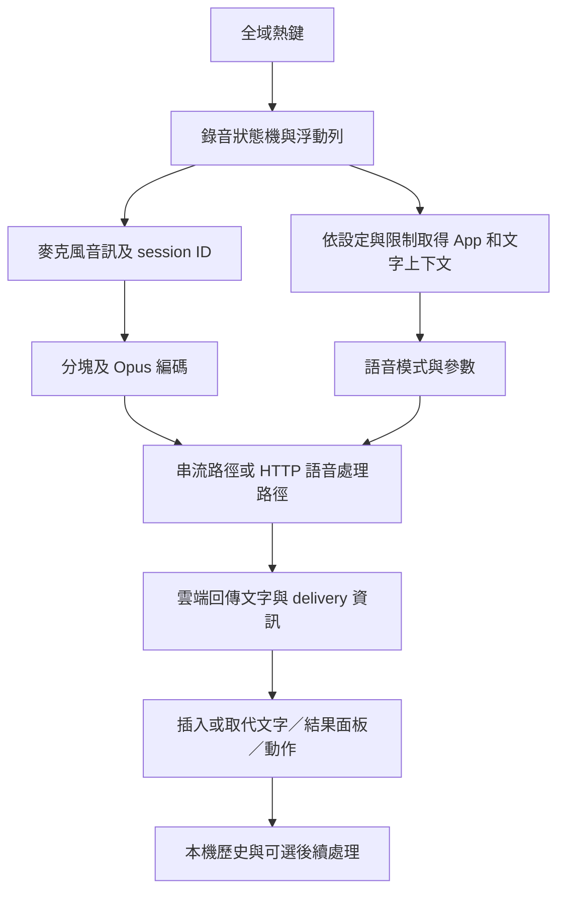

# Typeless macOS：功能與運作邏輯

查核日期：2026-10-24。對象為本機 `/Applications/Typeless.app`，版本 **2.8.3／build 2.8.3.132**。使用 `reverse-engineer-anything` skill 與已連線 REA MCP 分析實際發行套件，另以 Typeless 官方網站核對產品功能。

**核心結論：Typeless 是整合全域熱鍵、語音擷取、上下文、雲端語音處理、文字整理與跨 App 輸入的 Electron 桌面產品。** 本機程式碼能揭露桌面端流程與 API 資料欄位；伺服器內部的 ASR、LLM、prompt 與模型路由仍未知。公司目前只有文字 LLM API，因此公司版本需要另補語音辨識。

## 1. 證據如何閱讀

| 標記 | 意義 | 能支持的結論 |
| --- | --- | --- |
| 官方描述 | Typeless 官網／政策聲明 | 產品宣稱的功能與資料處理方式，沒有等同本次實測 |
| 套件觀察 | 已安裝 App 的檔案、manifest、SQL、靜態程式碼 | 這個版本包含的元件、欄位、分支與 API 呼叫語法 |
| 靜態推論 | 沿程式碼整理的功能流程 | 可解釋設計；不能證明該分支本次執行或所有 App 都可用 |
| 未驗證 | 沒有對應 runtime／伺服器證據 | 保留 unknown，不用宣傳或函式名稱補成事實 |

本報告沒有啟動聽寫、錄音、登入、送出語音、檢視使用者的歷史資料庫或擷取目前其他 App 的文字。沒有 UI、網路封包、延遲或辨識率驗收。

## 2. 功能清單

| 功能 | 使用者會看到的行為 | 本次依據與邊界 |
| --- | --- | --- |
| 系統全域語音輸入 | 在原本 App 中用熱鍵說話，文字回到輸入位置 | 官方 FAQ 說明 Accessibility 與 Fn；套件有 keyboard helper、input helper 與文字插入 binding。未逐一驗收 App。[官方 FAQ](https://www.typeless.com/help/faqs)，T03、T14 |
| 按住說話／免手持模式 | 熱鍵按下、放開或切換狀態，浮動列顯示錄音／處理 | renderer 有 `pushToTalk`、`handsFree`、`recording_active`、`stopping` 等狀態。屬靜態狀態機觀察，T14 |
| 智慧整理聽寫 | 去贅詞、重複與口頭修正，整理段落及清單 | [官方首頁](https://www.typeless.com/) 的 Dictate 功能；客戶端讀回 `refine_text`，不能得知伺服器精確演算法，T06 |
| 依個人／App 調整風格 | 保留說話者風格，依郵件或聊天情境調整語氣 | 官方首頁描述；套件有 App／輸入框上下文蒐集與編輯追蹤。無法據此證明個人模型微調或預設會蒐集哪些文字，T02、T07 |
| 個人字典 | 加入人名、公司名、術語；可自動或手動加入 | 官方首頁描述；套件有 dictionary route 與選單。自動學習的伺服器規則未知，T09 |
| 多語與中途切換語言 | 自動判斷語言、混合語言聽寫 | 官方首頁標示 100+ 語言。此為官方能力描述；本次未測繁中或中英夾雜 |
| 語音翻譯 | 說一種語言，輸出指定語言 | 官方首頁與套件 `voice_translation`、`output_language` 分支，T01、T05 |
| 選取文字後下語音指令 | 改短、改長、改語氣、翻譯，或產生草稿 | [Ask anything 官方頁](https://www.typeless.com/ask-anything)；套件 `voice_command` 與 `selected_text` 參數，T01、T05 |
| 對選取內容問答 | 摘要、解釋或翻譯文章／文件選取文字 | Ask anything 官方頁；客戶端有選取文字與結果面板元件。未驗證唯讀 PDF／網頁的擷取成功率 |
| 問答、搜尋與動作 | 彈出答案、插入草稿或開啟搜尋頁 | 官方 Ask anything；回應 parser 有 `delivery`、`web_metadata`、`external_action`，但完整動作協定與限制未知，T06 |
| 本機歷史、重新處理相關流程 | 保存聽寫紀錄、內容狀態及可選同步 | 套件 SQL／Drizzle schema 與 sync API；官方政策說明可選 History cloud sync，T01、T08 |
| 系統列、麥克風與設定 | 系統列入口、選麥克風、登入與首次設定、更新 | 套件有 `hub`、`floating-bar`、`interactive-card`、`sidebar`、`login`、`onboarding` 頁面及相關主程式分支。是否可用依登入／政策／產品狀態而異 |

T01～T16 為 [靜態證據摘錄](evidence/typeless-static-excerpts.json) 的識別碼。官方提到的速度、準確率、支援 App 數量等宣傳數字，這次沒有量測，也沒有列為已驗證結果。

## 3. 實際套件組成

| 層 | 直接看到的元件 | 對公司版本的意義 |
| --- | --- | --- |
| 桌面殼層 | Electron Framework、`app.asar`、main、preload、renderer HTML／JS；package manifest 含 React 相關套件 | npm／TypeScript／React 可以包成桌面 App；同事使用時不必開發環境 |
| 作業系統整合 | `libKeyboardHelper.dylib`、`libInputHelper.dylib`、`libContextHelper.dylib`、`libUtilHelper.dylib`，JavaScript 經 Koffi 呼叫 native binding | 難點包含全域熱鍵、焦點與送字；單一網頁無法完整取代這些整合 |
| 音訊 | `chunkSessionWorker.js`、`opusWorker.js`、`libopuschunk.dylib`、`libopusenc.dylib` | 壓縮／分塊與模型辨識是不同工作；發現 Opus 不代表發現本機 ASR |
| 本機資料 | `better-sqlite3`、Drizzle、`drizzle/*.sql`；history schema 含文字、音訊／路徑、context、mode、狀態、編輯結果等欄位 | 歷史紀錄是產品功能；schema 有欄位不代表本次有資料，亦不證明預設保存期限 |
| 外部服務 | 語音處理、登入、同步、更新等路徑；manifest 含 Sentry | 本機安裝及本機 history 不等於推論離線；SDK 存在不證明某次 telemetry 已送出 |

檔案身分、89 個選讀來源的 SHA-256 與 6 個原生 library 身分，見 [artifact identity](evidence/typeless-artifact-identity.json)。manifest 的 dependency version range 不等於每個實際安裝套件的精確版本。

`package.json` 同時帶有 `private: true` 與 `license: "MIT"`。這只是封裝內 metadata；本次沒有找到對整個 Typeless 產品公開原始碼與完整授權的證據，不能據此把 Typeless 當作可直接 fork 的 MIT repository。

## 4. 一次聽寫的桌面端邏輯

以下為套件靜態觀察整理的流程；箭頭沒有代表本次已執行。

1. **接收熱鍵並進入錄音狀態。** renderer 的狀態機區分按住、免手持與翻譯等狀態；有 timeout、停止、取消與清理分支。不能僅憑一個快捷鍵 listener 還原完整互動，T14。
2. **建立音訊與上下文。** 主程式有 App identity、焦點／選取文字、相關內容與可見文字等蒐集介面；另有 App／URL 規則與停用判斷。實際收集結果受 OS 權限、設定與目標 App 限制，T02。
3. **編碼、傳送並等待結果。** worker 經 Koffi 呼叫 Opus native library。floating renderer 有 `START_AUDIO`、`END_AUDIO`、audio chunk 與弱網路降級相關分支；主程式另有完整音訊 HTTP request。這是兩類路徑的靜態證據，沒有實測串流時序或切換成功率，T04～T06、T11～T16。
4. **解讀模式與結果。** 模式包含 `voice_transcript`、`voice_command`、`voice_translation`；回應 parser 讀取整理後文字及交付方式。選取編輯與翻譯共用部分基礎流程，T01、T05、T06。
5. **送字與保存狀態。** native binding 提供 `insertText`、`insertRichText`、`deleteBackward`、選取文字／輸入狀態相關函式。本次沒有反組譯原生 library，所以它們內部究竟如何使用 Accessibility、剪貼簿與鍵盤事件，仍未知，T03。

## 5. 已確認的 HTTP 語音處理介面

主程式註冊 IPC handler `audio:ai-voice-flow`，取得對應 history／audio session 後建立 `FormData`，送到 `POST /ai/voice_flow`。這是客戶端靜態程式碼觀察，沒有呼叫該 API。

| 請求欄位 | 套件觀察 |
| --- | --- |
| `audio_id`、`mode` | 識別一次語音處理與模式 |
| `audio_file` | 以 `audio/ogg` File 包裝傳入 buffer |
| `audio_context`、`audio_metadata` | JSON 化的上下文與音訊 metadata |
| `parameters.selected_text` | 語音命令模式下的選取文字 |
| `parameters.output_language` | 翻譯模式下的目標語言 |
| 其他可選欄位 | retry、時間、麥克風名稱等 |

回應處理會讀 `refine_text`、`delivery`、`user_prompt`、`web_metadata`、`external_action`；另有錯誤／取消／通知處理。所見 HTTP 分支 timeout 表達式為 `0x28 * 0x3e8`，即 **40,000 ms**。這是設定值，不是實測回應時間。[T04～T06](evidence/typeless-static-excerpts.json)

不能把這個 endpoint 直接換成公司的文字 LLM URL：此請求帶音訊與 Typeless 特有欄位，公司的文字模型目前無法負責整段語音辨識。

## 6. 雲端與內網的差異

Typeless 的 [Data Controls](https://www.typeless.com/data-controls) 明寫 transcription 在雲端執行；[Privacy Policy](https://www.typeless.com/privacy) 的 2026-10-13 版本也說明語音與相關上下文會在雲端即時處理，History cloud sync 為可選功能。這些是廠商政策聲明，本次沒有獨立驗證刪除或資料保留行為。

本次沒有找到「一般使用者可把所有 Typeless 語音／模型服務改成公司 API」的已驗證設定入口。搜尋範圍是本機選讀套件與已讀官方頁面，不能因此宣稱產品絕對沒有企業部署方案。

公司版本適合重用的概念是熱鍵、短錄音 session、整理文字、字典及貼回游標。公司的主路徑建議改成 **本機 ASR → 公司文字 LLM → Windows 輸入**；不需要重製 Typeless 的登入、訂閱、雲端同步與外部搜尋服務。

## 7. REA 結果的限制

- REA parent Evidence：`ev_1c6631fb12d64494f351837ddac8de0927d5144963b5ab894cfc404737fddfa4`。保留的 summary 與限制見 [REA summary](evidence/typeless-rea-summary.json)。
- 選定 6 個來源路徑，5 個 JavaScript 檔案解析成功、parse failures 為 0；未選讀 10,492 個 relevant inventoried files。這不代表完整 App 解析／功能驗收通過。
- application 與 semantic graph 均為 `partial`；floating renderer 的部分 semantic graph 因 parent result budget 限制而未展開。混淆也讓多數 IPC channel 無法靜態解析。保留的未知項目不可當作功能缺失。
- 初次 strict integrity 檢查失敗。以 `record-and-continue` 重跑後，REA 記錄 **better-sqlite3 與 Koffi 兩個 unpacked native 模組**的宣告／實際 hash 不同。原因未知，這兩個檔案的 observed bytes 標為 untrusted；不能據此斷言遭竄改，也不能宣稱封裝完整性通過。
- 為閱讀混淆的字串查表，另做有限的靜態 literal substitution。只處理 literal、算術與表格輪轉，沒有執行目標 JavaScript；它不是完整反混淆器或控制流程證明。原始 byte range 與對照摘錄均保留。
- 未反組譯原生 helper、未取得伺服器程式碼。實際 ASR／LLM 型號、完整 prompt、模型組合、線上延遲、字典學習方法與 Windows 行為維持未知。
