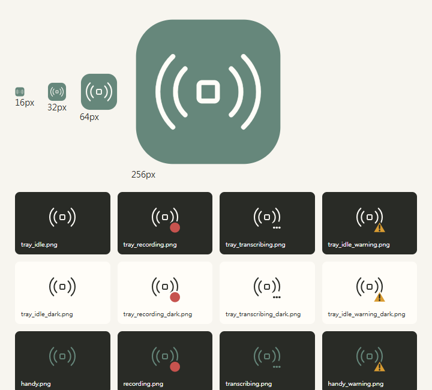

# 05 波紋與無模型 portable ZIP

套件版本：`0.1.2-local.1`。原生產品來源：[`bc20d5eb512439c68aefe65b8c9985f106b9768c`](https://github.com/swchen44/notype/commit/bc20d5eb512439c68aefe65b8c9985f106b9768c)。後續驗證文件不改變二進位內容；原生基底版本仍為 `0.1.1`。

核准：[P40-v1](https://github.com/swchen44/notype/issues/40#issuecomment-6550897525)、[GPT-6-Astra APPROVED／0 unresolved](https://github.com/swchen44/notype/issues/40#issuecomment-6550913830)。交付位置：[v0.1.2-local.1](https://github.com/swchen44/notype/releases/tag/v0.1.2-local.1)。

## 圖示與操作說明

依使用者指定的 `icon-design.html` 第 05 款「波紋」保存原始 SVG 幾何與配色。更新全部 51 個既有平台圖示、12 個系統匣狀態圖、側欄／初次設定品牌及 favicon。錄音紅點、處理中三點與警告三角形仍可區分；功能按鈕圖示及歷史截圖保留。

以 Tauri icon generator 從 canonical SVG 產生平台圖示，以本機 Edge／Playwright 呈現透明 PNG 狀態圖。已目視檢查 16／32／64／256px 和深淺背景，並從實際新編譯 EXE 擷取 Windows 圖示確認。



根目錄 README 與 ZIP 內 `README-zh-TW.md` 均明確說明：本版不附語音辨識模型，使用者另外下載 `.gguf`、核對 SHA-256，放入程式目錄之外的模型資料夾最上層，再於 App 選取資料夾、重新掃描及選取模型。

## 已執行

| 範圍 | 結果 |
| --- | --- |
| Unit：`tests/unittest/portable-package.test.mjs` | 12 passed，0 failed／skipped |
| Integration：`portable-cli.test.mjs`、`model-roots-launcher.test.mjs` | 4 passed，0 failed／skipped；包含無模型啟動且不複製模型 |
| Rendered UI：`tests/integration/model-roots.ui.mjs` | 27 passed，0 failed／skipped；涵蓋新使用者、資料夾復原、唯讀與重新掃描 |
| Frontend ESLint／TypeScript／Vite／修改檔案 Prettier | 通過；Vite 保留大型 chunk 提示 |
| Windows 原生 Release 編譯 | 通過，581,194 ms；26 項 unused-code／import 等警告，0 編譯錯誤 |
| 封裝／獨立解壓 | 完整 inventory、逐檔 SHA-256／CRC、PE DLL／export closure、bundled Node `--check`、`inspectRelease`、無模型 `prepareLaunch` 全通過 |
| 真正原生 headless smoke | 解壓出的 EXE 在全新自有資料目錄、實際 medium token／AVX2／BMI2 host gate 下執行 `--list-models`，exit 0，未逾時 |

```powershell
node --test tests/unittest/portable-package.test.mjs tests/integration/portable-cli.test.mjs tests/integration/model-roots-launcher.test.mjs
node --test tests/integration/model-roots.ui.mjs
# 從 desktop/ 執行：
bun run lint
bun run build
bun x --no-install prettier --write src/components/icons/HandyHand.tsx src/components/icons/HandyTextLogo.tsx index.html
bun run tauri build --no-bundle -- --offline --locked --bin notype
```

原生編譯獨佔重用既有快取與已保存的 CPU transcribe prefix，compiler temp 放在 C:，監看磁碟餘裕，未刪除快取。產品來源及 dependency locks 未變動；Tauri 的等價 Cargo.toml 換行重寫經 Git blob 比對後還原。

## 實際 ZIP

- 檔名：`notype-0.1.2-local.1-portable-win-x64.zip`。
- ZIP：384,409,745 bytes；解壓：892,323,350 bytes；1,723 個檔案。
- SHA-256：`283a550be00fbab7c1abc928e6230e7e290f8ae972d17599d15de2a6f8271d10`。
- EXE：60,948,992 bytes；SHA-256：`c86e6d3a82529ae46be679bb98a8875831aa558788bbce991d71a41d0f58b3dc`。
- 保留完整 Fixed WebView2 的 257 個 vendor 檔案、Node 22.15.0、原生 DLL、資源及授權聲明。
- 僅從完整性檢查通過的 local.7 baseline 重用 app／runtime，替換新 EXE、已審查狀態資源及相符 DLL，再重建版本、來源與 manifest hashes。
- 不包含 ASR 權重、模型套件、`models` 配送目錄或私人設定。程式本身必要的微小 VAD 資源保留。
- 使用既有 schema-2 base launcher；`Start-notype.cmd` 呼叫隨附 Node，未使用需要模型配送 metadata 的 `--offline-bundle` 模式。
- ZIP 使用既有 `scripts/release/archive.py` 及 `inspectZipArchive` 寫入、核對，再全新解壓重跑檢查。

## 未執行

本輪未進行完整原生 GUI 驗收、麥克風／快捷鍵／真實 ASR 品質、公司 API／Proxy 或無開發工具的乾淨 Windows 主機驗收。headless smoke 與 rendered UI 不代表這些項目已通過。
